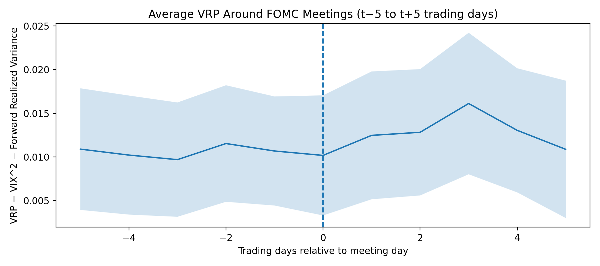
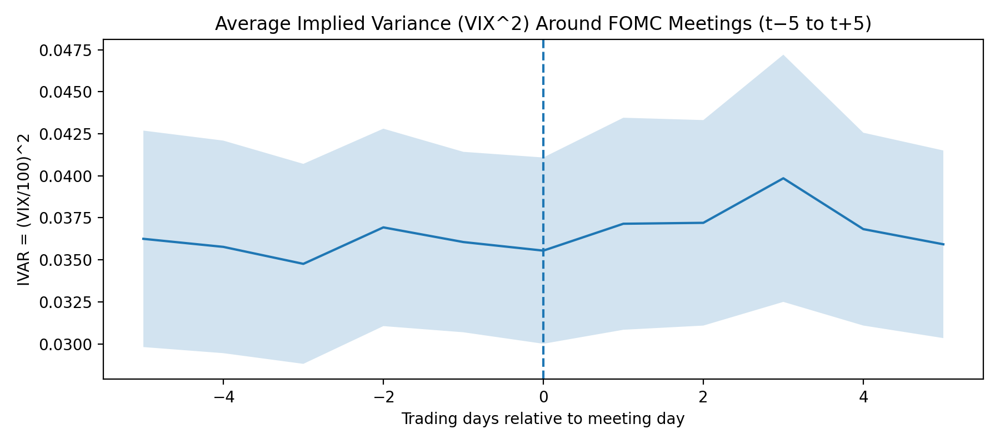
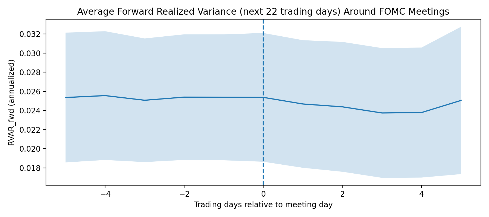

# FOMC News and the S&P 500 Variance Risk Premium

**How do monetary-policy surprises and the language of Federal Reserve announcements relate to the pricing of equity-market uncertainty?** In my Spring 2026 Penn State honors thesis, I study this question around scheduled Federal Open Market Committee (FOMC) statement releases.

My thesis, *Hard News, Soft News, and the S&P 500 Variance Risk Premium on FOMC Statement Days*, is available through **[Penn State University Libraries](https://honors.libraries.psu.edu/catalog/10189ava6461)**. This repository contains the accompanying research notebooks, figures, and tables.

## Research question

FOMC announcements convey both a policy decision and information about the economic outlook. I distinguish between **hard news**, measured through futures-based monetary-policy surprises, and **soft news**, measured through the tone of the accompanying statement. I ask whether statement tone helps explain differences in the meeting-day variance spread beyond the policy-surprise measure and pre-meeting volatility.

I focus on variance because announcements may affect both option-implied uncertainty and the volatility subsequently realized in the equity market. Examining those components separately helps interpret an association in their difference.

## Data and measurement

The submitted study covers **78 scheduled FOMC events during 2016–2025** and **2,492 daily observations** in its variance dataset.

| Component | How I measure it |
| :--- | :--- |
| Implied variance | Daily VIX converted to decimal units and squared: `(VIX / 100)^2` |
| Realized variance | Sum of squared S&P 500 log returns over the next 22 trading days, annualized |
| Variance-spread proxy | Implied variance minus subsequently realized variance |
| Policy surprise | First principal component of four standardized futures-rate changes from the U.S. Monetary Policy Event-Study Database |
| Statement tone | Loughran–McDonald dictionary measures and inference with the pretrained `yiyanghkust/finbert-tone` model |
| Pre-meeting conditions | Lagged implied variance and backward-looking realized variance |

I combine S&P 500 and VIX series from FRED, event and futures data from the San Francisco Fed's USMPD, and Federal Reserve statement text. Provider and model attribution is recorded in [DATA_SOURCES.md](DATA_SOURCES.md).

The variable labeled `vrp` in my code is an **ex-post variance-spread proxy**. Its realized-variance component is observed only afterward; it is not a directly observable event-time risk premium or trading signal.

## Empirical approach

I first construct event profiles from five trading days before to five trading days after each announcement. I then compare the policy-surprise and statement-tone measures in OLS regressions with pre-meeting volatility controls. I use HC1 robust standard errors for meeting-level specifications and HAC(22) inference in the daily specification.

To examine sensitivity, I compare level and change specifications, apply 1% tail winsorization, separate the implied- and realized-variance channels, and assess influential observations using Cook's distance and leave-one-out refits. These exercises investigate the stability and interpretation of the estimated associations.

## Findings reported in the thesis

### Policy surprises and statement tone

In my original meeting-level regressions, I find **no statistically significant association for the conventional policy-surprise or dictionary-tone measures** after controlling for pre-meeting volatility. In contrast, **more positive FinBERT statement tone is associated with a lower meeting-day variance-spread proxy** in the reported baseline specification.

| Reported specification | Coefficient of interest | HC1 robust standard error | Model R² |
| :--- | ---: | ---: | ---: |
| Policy surprise + volatility controls | Policy surprise: 0.0010 | 0.0018 | 0.0821 |
| Policy surprise + dictionary tone + volatility controls | Dictionary tone: −0.0689 | 0.8081 | 0.0824 |
| Policy surprise + standardized FinBERT tone + volatility controls | FinBERT tone: −0.0090 | 0.0032 | 0.1508 |

All three specifications use **78 FOMC meetings** and control for lagged implied variance and backward-looking realized variance. The coefficients use different predictor scales and should not be compared directly. Sources: [conventional-measure regressions](reports/tables/reg_vrp_surprise_tone_controls.tex) and [standardized FinBERT regression](reports/tables/reg_vrp_finbert_standardized.tex).

In the FinBERT specification, a **one-standard-deviation increase in tone is associated with a 0.0090 lower annualized variance spread** (`p = 0.0048`). This is measured in decimal variance units, not investment returns or volatility percentage points. The model's in-sample R² is about **15.1%**, compared with **8.2%** for policy surprises and volatility controls alone. I interpret this as evidence of an association worth investigating, rather than proof of predictive performance.

### Sensitivity to influential meetings

I also examine whether a few influential meetings drive the FinBERT result. The reported standardized-tone coefficient remains negative when I remove the one, two, or five observations with the highest Cook's distance:

| Sample | Meetings | Standardized-tone coefficient | p-value |
| :--- | ---: | ---: | ---: |
| Original sample | 78 | −0.0090 | 0.0048 |
| Excluding the most influential meeting | 77 | −0.0092 | 0.0046 |
| Excluding the two most influential meetings | 76 | −0.0074 | 0.0051 |
| Excluding the five most influential meetings | 73 | −0.0056 | 0.0119 |

The estimated magnitude becomes smaller after removing the five most influential meetings, although it remains statistically significant at the 5% level in this exercise. These are in-sample sensitivity checks, not out-of-sample validation. Source: [saved influence results](reports/tables/finbert_influence_robustness.tex).

### Event-study graphs from my thesis

These are the original saved figures corresponding to Figures 4.1–4.3 of my thesis. Day 0 marks the scheduled FOMC statement date. Each line averages observations at the indicated trading-day offset; the shaded bands show the original mean ± 1.96 standard errors. The bands are fairly wide, so I treat these profiles as descriptive rather than evidence of a causal announcement effect.

**Variance spread (Figure 4.1).** I observe a positive average spread throughout this window. It rises after the meeting, reaches its highest plotted mean around day +3, and then falls toward its pre-meeting level.

**Implied variance (Figure 4.2).** The average implied-variance profile also rises after the meeting and peaks around day +3, resembling the spread's post-meeting pattern.

**Forward realized variance (Figure 4.3).** Average subsequent realized variance changes less across the window and declines modestly after day 0. Each point uses the following 22 trading days, so neighboring windows overlap and this measure is only known afterward.

Together, these findings motivated my interest in whether contextual language measures capture information that simple word counts and futures surprises miss. They are retrospective, in-sample findings from the original analysis; the study does not establish causality or out-of-sample trading performance. The current status of these estimates is noted at the bottom of this README.

## Explore the research

| Material | Contents |
| :--- | :--- |
| [Penn State University Libraries](https://honors.libraries.psu.edu/catalog/10189ava6461) | Full submitted thesis |
| [notebooks/](notebooks) | Original workflow: variance construction, event study, statement measures, regressions, and FinBERT inference |
| [reports/figures/](reports/figures) | Saved variance-series and FOMC event-profile figures |
| [reports/tables/](reports/tables) | Saved summary statistics, regressions, and sensitivity results |
| [DATA_SOURCES.md](DATA_SOURCES.md) | Input sources and dependencies |
| [ARCHIVE.md](ARCHIVE.md) | Historical version selection and preservation details |

## Future research

I would like to explore **testing my assumptions through a trading strategy** after completing the research corrections. A separate study could ask whether statement tone and policy surprises add predictive information for a specified tradable volatility or variance exposure beyond simple volatility and event-calendar baselines.

That extension would use information available at entry, chronological out-of-sample evaluation, realistic execution and transaction costs, and appropriate benchmarks. I have not implemented or backtested a strategy here. My [next-steps plan](NEXT_STEPS.md) describes this possibility in more detail.

## Research status

**The original analysis remains unchanged. Codex's subsequent review found several implementation and documentation mistakes, including incomplete statement extraction, inconsistent data snapshots, and environment/project-path problems.** The text-extraction issue means the reported tone findings need to be reassessed. **My next steps are to fix these issues myself, rerun the analysis, and report any changes to the conclusions.**

Codex helped document these findings and prepare the repository; it did not correct the research. Saved outputs have not been regenerated, and this is not yet a verified, self-contained reproduction package. See [KNOWN_ISSUES.md](KNOWN_ISSUES.md) for the evidence and [NEXT_STEPS.md](NEXT_STEPS.md) for my correction plan.
